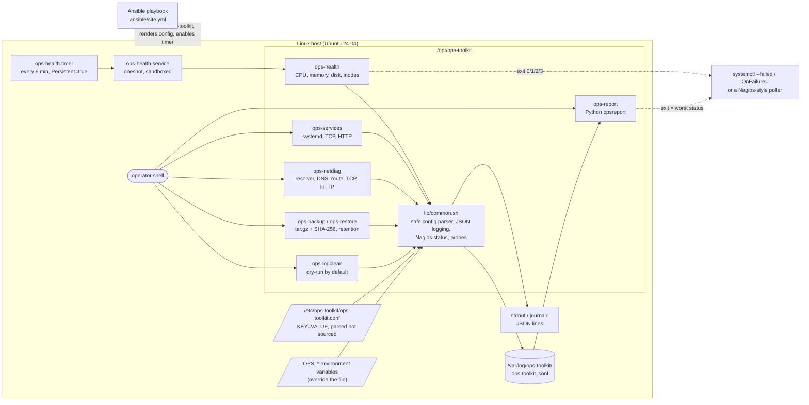

# HostMedic

**Purpose:** keep a single Linux server healthy without a full monitoring stack: scheduled health checks, network diagnosis, verified backups and safe log cleanup, each reporting a concrete next step.

A small operations toolkit for Ubuntu servers, written in Bash with a little Python. It checks
host health (CPU load, memory, disk and inode usage), service availability (systemd units, TCP
ports, HTTP endpoints) and network paths (DNS, routing, TCP, HTTP), takes verified backups,
cleans old logs safely, and writes every result as a JSON line with a concrete next step.
A systemd timer runs the health check every five minutes and an Ansible playbook installs it.

Why it exists: these are the first things an operations engineer checks during an incident,
and doing them by hand is slow and inconsistent. Each command is small enough to read in one
sitting, follows the Nagios exit-code convention so monitoring systems can call it, and refuses
dangerous input instead of trusting it.

| Command | What it does |
|---|---|
| `ops-health` | load average vs. CPU cores, busy/iowait/steal %, memory used (from MemAvailable), disk and inode usage per mount, top CPU/memory processes |
| `ops-services` | `systemctl is-active` for units, TCP connect with timeout, HTTP status vs. expected (curl with timeouts) |
| `ops-netdiag HOST [PORT]` | nameservers, nsswitch `hosts:` line, `getent ahosts`, default route and `ip route get`, TCP connect, optional HTTP status |
| `ops-backup` / `ops-restore` | tar.gz of configured directories + SHA-256 manifest, retention, `flock`, verified restore |
| `ops-logclean` | compress `*.log` older than N days, delete `*.log.gz` older than M days, inside one directory, dry-run by default |
| `ops-report` | Python (stdlib only): counts by level/check, latest WARN/CRIT with hints, `--since`, exit code = worst status |

## Architecture



Layout:

```
bin/        ops-health ops-services ops-netdiag ops-backup ops-restore ops-logclean ops-report
lib/        common.sh - config parser, JSON logging, status tracking, TCP/HTTP probes, safety checks
opsreport/  Python log summarizer (stdlib only)
config/     ops-toolkit.conf.example
systemd/    ops-health.service, ops-health.timer
ansible/    site.yml, inventory.ini, roles/ops_toolkit, test-in-docker.sh
tests/      pytest suite (runs the real scripts), systemd-check.sh
samples/    JSON logs captured from real runs
docs/       troubleshooting.md (runbook), verification.md (evidence)
```

## Prerequisites

- Ubuntu 24.04 (or another systemd-based Linux) with bash 5, coreutils, findutils, gawk, curl,
  iproute2, procps, tar, gzip, util-linux (`flock`) and python3. Ubuntu Server ships all of them;
  the Ansible role installs any that are missing.
- On Windows 11: WSL2 with Ubuntu 24.04 (systemd enabled for the timer), or Docker Desktop to run
  the Ansible container test.
- For development: Python 3.10+ with `pip install -r requirements-dev.txt` (pytest, ruff),
  `shellcheck`, optionally `actionlint`; Docker for `ansible/test-in-docker.sh`.

## Quick start

Run straight from the checkout (no installation, no root needed):

```bash
cd hostmedic
bin/ops-health --help
OPS_DISK_MOUNTS=/ bin/ops-health | jq -c '{level, check, msg}'
bin/ops-netdiag --http github.com 443
bin/ops-report            # summarizes ${XDG_STATE_HOME:-~/.local/state}/ops-toolkit/ops-toolkit.jsonl
```

Install on a server with Ansible (copies to `/opt/ops-toolkit`, links commands into
`/usr/local/bin`, renders `/etc/ops-toolkit/ops-toolkit.conf` as root:root 0640, installs and
enables `ops-health.timer`):

```bash
pip install ansible-core==2.21.4
ansible-playbook -i ansible/inventory.ini ansible/site.yml                 # edit inventory first
ansible-playbook -i ansible/inventory.ini ansible/site.yml -e ops_toolkit_manage_systemd=false  # no systemd
systemctl list-timers ops-health.timer
journalctl -u ops-health.service -n 20 --no-pager
```

## Usage examples (real output)

All excerpts below are copied from runs on Ubuntu 24.04 in WSL2 on 2026-10-10. Full raw output
is in `evidence/execution-logs/` in this repository.

**Host health on the WSL host** (default thresholds). The Windows drives mounted under `/mnt`
really are 90-99 % full, so this is a genuine CRITICAL; exit code 2:

```text
$ ops-health | jq -c 'select(.level != "OK") | {level, check, msg}'
{"level":"CRIT","check":"disk","msg":"/usr/lib/wsl/drivers is 90% full (>= crit threshold 90%)"}
{"level":"WARN","check":"disk","msg":"/ is 84% full (>= warn threshold 80%)"}
{"level":"CRIT","check":"disk","msg":"/mnt/c is 90% full (>= crit threshold 90%)"}
{"level":"CRIT","check":"disk","msg":"/mnt/d is 99% full (>= crit threshold 90%)"}
{"level":"CRIT","check":"disk","msg":"/mnt/e is 91% full (>= crit threshold 90%)"}
{"level":"CRIT","check":"summary","msg":"ops-health CRITICAL: 4 critical, 1 warning, 0 unknown, 6 ok"}
```

A full event carries the observed value, both thresholds, the one that was crossed and a hint:

```json
{"ts":"2026-10-10T15:32:40Z","level":"WARN","tool":"ops-health","check":"disk","host":"BABAYAGA","msg":"/ is 84% full (>= warn threshold 80%)","mount":"/","value":84,"unit":"%","warn":80,"crit":90,"threshold":80,"fstype":"ext4","source":"/dev/sdd","hint":"find what grew: du -xh --max-depth=1 / | sort -h | tail; space held by deleted-but-open files: lsof +L1; journal size: journalctl --disk-usage"}
```

**Services**: `cron.service` active, `nginx.service` not installed, a local app whose
`/healthz` answers 503, and a closed port (exit code 2):

```json
{"ts":"2026-10-10T15:32:44Z","level":"CRIT","tool":"ops-services","check":"systemd","host":"BABAYAGA","msg":"nginx.service is inactive (expected active)","unit":"nginx.service","state":"inactive","hint":"see why: systemctl status nginx.service --no-pager; journalctl -u nginx.service -n 50 --no-pager; after fixing: sudo systemctl restart nginx.service"}
{"ts":"2026-10-10T15:32:44Z","level":"CRIT","tool":"ops-services","check":"http","host":"BABAYAGA","msg":"http://127.0.0.1:18080/healthz returned 503, expected 200","target":"http://127.0.0.1:18080/healthz","value":503,"expected":200,"response_ms":6,"hint":"the server answered but the application failed: check its logs (journalctl -u <unit>, docker logs <container>) and its dependencies (database, upstream APIs); reproduce with: curl -sv http://127.0.0.1:18080/healthz"}
```

**Network diagnosis**: `ops-netdiag --http github.com 443` passed all five steps (exit 0):

```json
{"ts":"2026-10-10T15:32:45Z","level":"OK","tool":"ops-netdiag","check":"tcp","host":"BABAYAGA","msg":"connected to github.com:443 in 153 ms","target":"github.com:443","connect_ms":153}
{"ts":"2026-10-10T15:32:50Z","level":"OK","tool":"ops-netdiag","check":"http","host":"BABAYAGA","msg":"https://github.com:443/ returned 200 (5013 ms)","target":"https://github.com:443/","value":200,"response_ms":5013}
```

and a name that cannot exist (`.invalid` is reserved), exit 2, TCP step skipped:

```json
{"ts":"2026-10-10T15:32:50Z","level":"CRIT","tool":"ops-netdiag","check":"dns","host":"BABAYAGA","msg":"DNS failed for ops-toolkit-demo.invalid: no address found (NXDOMAIN or no A/AAAA record)","getent_exit":2,"resolve_ms":61,"hint":"check the name for typos; check /etc/resolv.conf and 'resolvectl status'; ask the resolver directly: 'resolvectl query ops-toolkit-demo.invalid' or 'dig ops-toolkit-demo.invalid'; compare with a public resolver: 'dig ops-toolkit-demo.invalid @1.1.1.1'; check the 'hosts:' line in /etc/nsswitch.conf and /etc/hosts"}
```

**Backup, retention and a tampered archive** (`OPS_BACKUP_KEEP=2`, three runs):

```text
$ ls -l /tmp/ops-toolkit-demo.1V1AVs/backups
total 400
-rw------- 1 root root 200639 Oct 10 21:32 ops-backup-20261010T153251Z.tar.gz
-rw------- 1 root root    101 Oct 10 21:32 ops-backup-20261010T153251Z.tar.gz.sha256
-rw------- 1 root root 200639 Oct 10 21:32 ops-backup-20261010T153252Z.tar.gz
-rw------- 1 root root    101 Oct 10 21:32 ops-backup-20261010T153252Z.tar.gz.sha256
$ ops-restore /tmp/ops-toolkit-demo.1V1AVs/tampered.tar.gz /tmp/ops-toolkit-demo.1V1AVs/restore2
ops-restore: error: checksum mismatch for /tmp/ops-toolkit-demo.1V1AVs/tampered.tar.gz (expected 706ce82c3c4590400d46848169d1e3491ac216b868637e6d54fbf983650e2562, got 6060accfeffd68a323f48e28c89c02942406fa712fd29d0c1afebea1016275b7): the archive is corrupt or was modified; refusing to restore
ops-restore: hint: use another backup; compare with off-host copies of the .sha256 file
```

The untampered archive restored into an empty directory and `diff -r` against the source
reported no differences (exit 0).

**Log cleanup** is a dry run unless `--apply` is given, and refuses system directories:

```text
{"ts":"2026-10-10T15:32:53Z","level":"INFO","tool":"ops-logclean","check":"logclean","host":"BABAYAGA","msg":"dry-run in /tmp/ops-toolkit-demo.1V1AVs/applogs: would delete 1 file(s) (11115 bytes), would compress 2 file(s); nothing changed - re-run with --apply to act","dir":"/tmp/ops-toolkit-demo.1V1AVs/applogs","delete_count":1,"compress_count":2,"delete_bytes":11115,"mode":"dry-run"}
$ env OPS_LOGCLEAN_DIR=/ ops-logclean --apply
ops-logclean: error: refusing to clean / (resolved from /): root, system directory or home
ops-logclean: hint: point OPS_LOGCLEAN_DIR at one application's log directory
```

**Report** over the JSON log of all demo runs (excerpt; exit code 2 = worst status CRIT):

```text
$ ops-report /tmp/ops-toolkit-demo.1V1AVs/log/ops-toolkit.jsonl
events: 86  runs: 9  malformed lines: 0
by level: CRIT=19  ERROR=7  INFO=16  OK=38  UNKNOWN=1  WARN=5
by check:
  backup        INFO=4
  cpu           OK=5
  disk          CRIT=12  OK=7  WARN=4
  ...
latest problems (newest first, max 10):
  2026-10-10T15:32:53Z ERROR   BABAYAGA ops-logclean: refusing to clean /etc (resolved from /etc): root, system directory or home
      hint: point OPS_LOGCLEAN_DIR at one application's log directory
  ...
```

`samples/` holds three logs captured from these runs (stdout only):
`healthy-run.jsonl` (`OPS_DISK_MOUNTS=/ OPS_DISK_WARN=85 OPS_DISK_CRIT=95 ops-health`; the
thresholds were raised because the WSL root filesystem was already above 80 %),
`threshold-violation.jsonl` (`ops-health` with defaults) and `service-down.jsonl` (the services
example above).

## Configuration

`/etc/ops-toolkit/ops-toolkit.conf` (or the file in `OPS_CONFIG`), see
[`config/ops-toolkit.conf.example`](config/ops-toolkit.conf.example) for every key. Precedence:
**environment variable > config file > built-in default**, so `OPS_DISK_CRIT=95 ops-health`
overrides one value for one run.

The config is **parsed, never `source`d**. `lib/common.sh` reads it line by line, accepts only
lines matching `^[A-Z_][A-Z0-9_]*=`, only keys it knows (so a line cannot set `PATH` or
`LD_PRELOAD`), strips one pair of surrounding quotes and assigns the rest literally with
`printf -v`. Sourcing would execute `$(...)`, backticks or `; cmd` in the file with the caller's
privileges; the timer runs as root, so anyone able to edit the config would get a root shell.
The tests put `OPS_TOP_N=$(touch .../pwned-1)` and similar lines into a config and assert that no
file was created.

**JSON event fields:** `ts` (UTC ISO-8601), `level` (`OK`/`WARN`/`CRIT`/`UNKNOWN` for checks,
`INFO`/`WARN`/`ERROR` for actions), `tool`, `check`, `host`, `msg`, then check-specific fields such
as `value`, `warn`, `crit`, `threshold`, `mount`, `target`, `hint`. Events go to stdout and are
appended to `$OPS_LOG_DIR/ops-toolkit.jsonl` (default `/var/log/ops-toolkit` as root, otherwise
`${XDG_STATE_HOME:-~/.local/state}/ops-toolkit`).

**Exit codes:** checks (`ops-health`, `ops-services`, `ops-netdiag`, `ops-report`) return 0 OK,
1 WARNING, 2 CRITICAL, 3 UNKNOWN; the worst result wins, ordered CRITICAL > WARNING > UNKNOWN > OK
(a known critical problem is more actionable than a check that could not run). Actions
(`ops-backup`, `ops-restore`, `ops-logclean`) return 0 on success and 1 on failure or refusal.
Every command returns 64 (`EX_USAGE`) for bad arguments and supports `--help`.

## Running the tests

```bash
python3 -m venv .venv && . .venv/bin/activate
pip install -r requirements-dev.txt
python -m pytest -v                     # 155 tests, about 15 s
ruff check . && ruff format --check .
shellcheck -x bin/ops-* lib/common.sh tests/systemd-check.sh ansible/test-in-docker.sh
tests/systemd-check.sh                  # systemd-analyze verify/calendar/security
sudo tests/systemd-check.sh --transient # + one sandboxed run via systemd-run (nothing installed)
ansible/test-in-docker.sh               # playbook twice in ubuntu:24.04, requires changed=0 on run 2
```

The pytest suite runs the real scripts with `subprocess` in a temporary directory. Fake `df`,
`nproc`, `systemctl`, `ip` and `getent` commands are written to a stub directory placed first on
`PATH`, and a fake `/proc` (`OPS_PROC_ROOT`) supplies load and memory numbers, so threshold cases
are deterministic. Real sockets and a local HTTP server returning 200/503 cover the network
checks; backup tests compare restored trees byte by byte; log-cleanup tests age files with
`touch -d`. CI (`.github/workflows/ci.yml`) runs shellcheck, ruff, pytest, the Ansible syntax
check plus the container idempotency test, and `systemd-analyze verify`.

## Design choices

- **Bash for the checks, Python for the report.** The checks are glue around `df`, `ps`,
  `systemctl`, `getent`, `ip`, `curl` and `tar`, which is what shell is good at. Summarizing
  JSON with time filters is easier to get right and unit-test in Python (stdlib only).
- **One small library.** Config parsing, logging, status handling and the TCP/HTTP probes live in
  `lib/common.sh`, so each command reads as a list of checks.
- **`set -Eeuo pipefail` plus ERR and EXIT traps** that turn unexpected failures into an
  UNKNOWN/ERROR event instead of a silent or misleading exit code. Command output is read with `mapfile` rather than piped into
  `head`, because `head` closing the pipe early would make `pipefail` report SIGPIPE.
- **TCP checks use bash's `/dev/tcp` under `timeout`**: no dependency on a specific `nc` variant,
  and the error text distinguishes refused, timeout, DNS and no-route.
- **MemAvailable, not MemFree**, because page cache is reclaimable. **Load as % of cores**, so one
  threshold works on 2- and 64-core machines. ops-health also samples `/proc/stat` for one second
  to split busy, iowait and steal time.
- **`-mmin` instead of `-mtime` in ops-logclean**: `-mtime +7` means "at least 8 whole days".
  Deletion runs before compression so a dry run lists exactly what `--apply` will do.
- **systemd timer instead of cron**: journal logging, `Persistent=true` for missed runs,
  no overlapping runs, sandboxing. `SuccessExitStatus=1` keeps WARNINGs from failing the unit;
  CRITICAL/UNKNOWN fail it so `systemctl --failed` and `OnFailure=` can alert.
- **Ansible role with explicit file lists** (no directory copies that would pick up
  `__pycache__`), `cache_valid_time` on apt so a second run reports no changes, and the systemd
  tasks in a block guarded by `ops_toolkit_manage_systemd`.

## Security considerations

The tools are meant to run as root from a timer, so the threat model includes other local
users who can write to log, backup or restore directories, and config or environment values
that contain shell syntax. A read-only code review (by a separate review agent) found several
local privilege-escalation and data-loss paths in an earlier version; all were fixed and each
has a regression test (`tests/test_common.py` and the "regression" tests in the other files).

- Config is parsed, not sourced; unknown keys are ignored; numeric settings are validated
  (`^(0|[1-9][0-9]{0,8})$`, no octal surprises), WARN must not exceed CRIT and timeouts must be
  at least 1 s (`timeout 0` would mean "no timeout").
- Values never reach bash arithmetic unchecked: `$(( ))` evaluates text such as `a[$(cmd)]`, so
  even `/proc/stat` fields are matched against `^[0-9]+$` first.
- Hosts, ports, unit names and URLs are validated before they reach `getent`, `ip`, `systemctl`
  or `curl` (no leading `-`, so no option injection). curl runs with `-q` (ignore `~/.curlrc`),
  `-g` (no `{a,b}` URL globbing) and `--proto =http,https`. `TAR_OPTIONS` and `GZIP` are unset so
  the environment cannot add options to tar or gzip. `ops-report` runs Python with `-I`, so a
  `json.py` in the current directory is never imported.
- `ops-backup`: `umask 077` (archives 0600); the destination must be owned by the caller and not
  writable by group/others (otherwise a planted symlink at the lock or `*.partial` path could make
  root overwrite another file); `flock -n` on a lock opened with `>>`; refuses `/`, `/proc`,
  `/sys`, `/dev`, `/run`, relative or missing sources, a destination inside a source and system
  directories; renames `*.partial` only on success; retention deletes only files matching
  `ops-backup-YYYYmmddTHHMMSSZ.tar.gz` and never the archive it just wrote.
- `ops-restore`: an existing target must be owned by the caller and not group/other-writable; a
  new target is created with plain `mkdir -m 0700` after verification (fails if someone created it
  meanwhile). It verifies SHA-256 before touching the target, rejects absolute or `..` member
  names, refuses non-empty targets without `--force`, refuses `/`, system and home directories,
  and with `--force` refuses targets where a directory on the way to a member is a symlink (tar
  would follow it). A test confirms GNU tar replaces a symlinked *file* instead of writing through
  it. The `.sha256` file sits next to the archive, so it detects corruption and accidental
  changes, not an attacker who can rewrite both; keep the manifests off the host or sign them.
- `ops-logclean`: `find` without `-L` and with `-type f` never follows symlinks, `-xdev` stays on
  one filesystem, and with `--apply` find acts on each file itself (`-delete`,
  `-execdir gzip`) instead of the script re-opening the path later, so a directory swapped for a
  symlink after listing cannot redirect the action. gzip refuses to overwrite an existing `.gz`.
  `/`, system directories, `/var/log` itself (logrotate's job; rsyslog keeps quiet logs open) and
  every home directory from `getent passwd` are refused after resolving symlinks.
- The log writer refuses to append through a symlinked log file.
- Unexpected shell errors (an unset variable, a bad arithmetic expression) bypass bash's ERR
  trap and would exit 1, which reads as WARNING; an EXIT trap turns them into UNKNOWN/ERROR, and a
  failure never downgrades a CRITICAL already found.
- systemd unit: runs as root only to read the 0640 config, with `CapabilityBoundingSet=` empty,
  `NoNewPrivileges=yes`, `ProtectSystem=strict`, `ReadWritePaths=/var/log/ops-toolkit`,
  `PrivateTmp=yes`, `PrivateDevices=yes`, `RestrictAddressFamilies=AF_UNIX` and more;
  `systemd-analyze security --offline` rates it 3.2 ("OK").
- Residual risk: with `--force`, subdirectories created by an earlier restore may themselves be
  group/other-writable (modes come from the archive); restore into a fresh directory instead.

## Troubleshooting

See [docs/troubleshooting.md](docs/troubleshooting.md): high CPU and load, memory/OOM, disk full
(including deleted-but-open files and inode exhaustion), finding the process on a port, how DNS
resolution works on Linux, how permissions and sandboxing affect services, systemd timer vs. cron,
and problems with the toolkit itself.

## Cleanup

```bash
# Installed by Ansible:
sudo systemctl disable --now ops-health.timer
sudo rm -f /etc/systemd/system/ops-health.{service,timer} && sudo systemctl daemon-reload
sudo rm -rf /opt/ops-toolkit /etc/ops-toolkit /var/log/ops-toolkit
sudo rm -f /usr/local/bin/ops-{health,services,netdiag,backup,restore,logclean,report}
# Backups (only if you no longer need them): /var/backups/ops-toolkit
# Running from a checkout as a normal user leaves only ~/.local/state/ops-toolkit/
```

The test suite uses pytest temp directories; `ansible/test-in-docker.sh` removes its container on
exit; `tests/systemd-check.sh --transient` uses a transient unit and removes `/var/log/ops-toolkit`
if it created it.

## Verification evidence

[docs/verification.md](docs/verification.md) lists every requirement as executed, statically
validated or not implemented, with excerpts from the raw outputs saved under
`evidence/test-results/` and `evidence/execution-logs/`.

## Limitations and future improvements

- Single host, pull-based. No metrics backend: a Prometheus node_exporter textfile output or
  shipping the JSON lines to Loki would be the next step.
- `ps %cpu` is a lifetime average; the 1 s `/proc/stat` sample covers the whole host, not
  per-process. Per-process sampling would need `pidstat` or two `/proc/<pid>/stat` reads.
- The toolkit's own JSON log is not rotated; add a logrotate rule (or point `ops-logclean` at an
  archive directory) on long-lived hosts.
- Paths containing spaces are not supported in `OPS_BACKUP_SOURCES` (space-separated list).
- Backups are full archives each time, unencrypted, and their checksums are not signed.
- The systemd tasks of the playbook were validated (ansible-lint, syntax check; the units with
  `systemd-analyze verify` and a transient sandboxed run) but not applied end-to-end on a systemd
  host in this environment; the container test skips them.
- `ops-logclean` does not check whether a process still has a log file open before compressing it;
  it relies on the age threshold.
- The `ops-logclean` swap race and the restore-target race are prevented by design (find acts on
  the file itself; ownership and mode checks plus a non-`-p` `mkdir`), but the races themselves are
  not reproduced by an automated test, only the checks around them.
